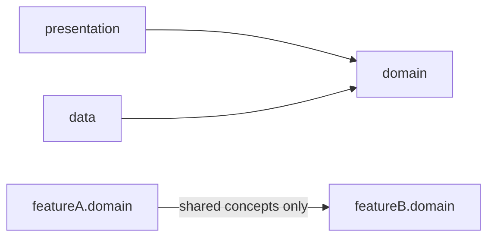
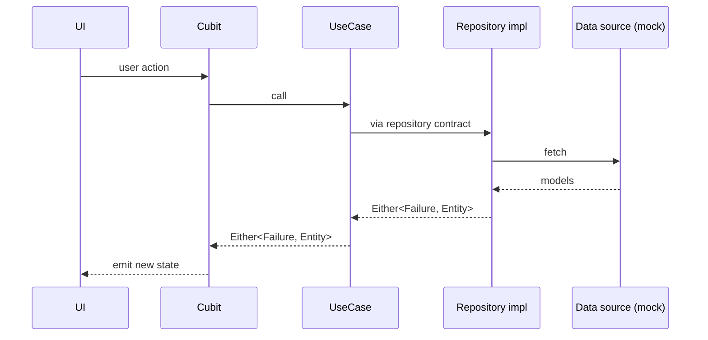

# Architecture

Feature-based Clean Architecture: each feature owns its `domain` / `data` / `presentation` slice under [lib/src/features/](../lib/src/features/).

## Folders

| Path | Contents |
|---|---|
| `lib/src/features/product/` | Catalog queries (category, tag, sale, keyword, sort, paging), product detail, reviews, search, app-wide favorites state |
| `lib/src/features/order/` | Orders (seeded history, place, cancel), My orders by status, order detail with timeline |
| `lib/src/features/banner/`, `category/`, `notification/` | Feature slices; `category/` also owns the Categories tab |
| `lib/src/features/profile/` | Presentation only: Profile tab (user, order counters, settings, reset demo data) and edit profile |
| `lib/src/features/settings/` | Device preferences (app language) |
| `lib/src/features/wishlist/` | Saved product ids (seeded on first launch) and the Wishlist tab |
| `lib/src/features/cart/` | Cart lines (seeded), app-wide cart state, Cart tab |
| `lib/src/features/checkout/` | Shipping, payment, vouchers, totals math, checkout and order-success screens |
| `lib/src/features/address/` | Address book (seeded) with pick mode for checkout |
| `lib/src/features/auth/` | Login screen + session; first launch saves the demo user, so the app opens signed in |
| `lib/src/features/home/` | Presentation only: composes banner, category and product-strip sections, each loading on its own |
| `lib/src/features/splash/`, `tutorial/`, `register/`, `bottom_tab/`, `preview_media/` | Screen flows |
| `lib/src/core/` | Constants (incl. `MockLatency`), enums, env, exceptions, failures, l10n, navigation (route constants in `routes/`), resources, usecase base, utils, shared widgets (`FloatingBottomNav`, `ProductTile`, states) |
| `lib/main_material_app.dart` | Provides app-wide Cubits (favorites, cart, notification badge, locale) above the router |
| `lib/src/di/injector.dart` | Calls each feature's `<Feature>Di.config()` |

## Feature layers

| Layer | Contents |
|---|---|
| `domain/` | Entities, repository contract, usecases, `domain.dart` barrel |
| `data/` | Models (DTOs), mappers, mock, data sources, repository impl |
| `presentation/` | Screens, Cubit controllers/states, feature-local widgets |

## Dependency rule

A feature exposes only its `domain/domain.dart` barrel, except to the presentation-only `home/` and `bottom_tab/`, which compose other features' sections. Cross-feature navigation uses the route helpers in `core/navigation/routes/` (query parameters, no argument classes).

## Data flow

`data/mock/*` stands in for a real API; swapping it only touches that feature's `data` layer.

## Backend DB design

| Resource | Link |
|---|---|
| DB design (Google Drive) | https://drive.google.com/file/d/1vY04Wm6R2z69D4JhJ8cdIqszU7TTXFpA/view?usp=sharing |
