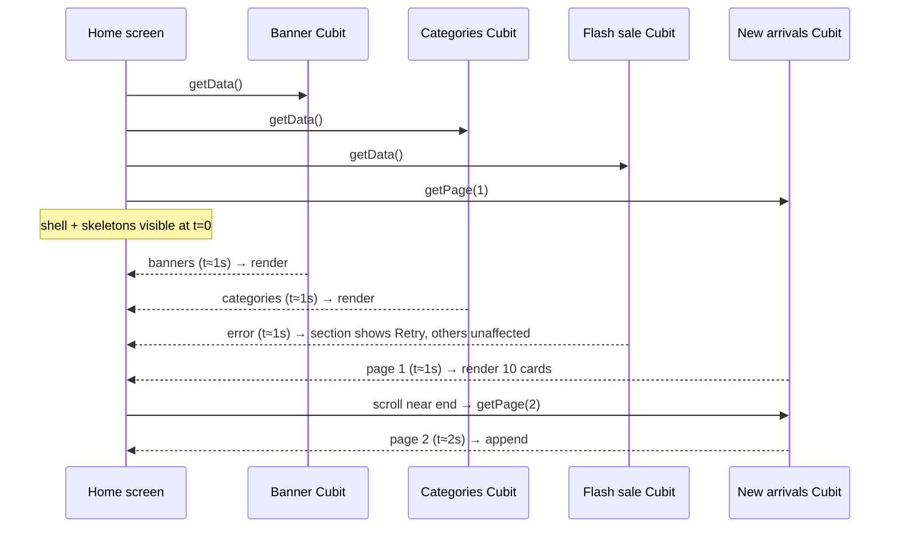
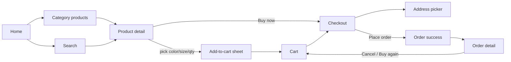

# Full shop flow plan

Turn Tuku Shop into a working clothing-store demo for client review: browse → product → wishlist / cart → checkout → order → track, all from mock data.

## Goals

| # | Goal | Done when |
|---|---|---|
| G1 | Real-looking fashion catalog | 14 clothing categories, ~70 products, bundled images from free-license photo sites |
| G2 | Full purchase flow | A reviewer can add to cart, check out, and see the new order in My Orders |
| G3 | Mock data only in data sources | No mock values in domain, presentation or core; swapping in an API touches only `data/` |
| G4 | Fixed 1 s latency | Every data source call waits exactly 1 s; no other artificial delay anywhere |
| G5 | Progressive loading | Every section loads and renders on its own; nothing waits for the whole screen |
| G6 | Repeatable demo | Same data on every launch; one tap resets the demo state |

## Rules for this work

| Rule | Reason | Where |
|---|---|---|
| Mock data and mock state live only in `data/mock/` and the data source that reads it | Same seam a real API will replace | `data/data_sources/*_data_source.dart` |
| Every data source method starts with `await MockLatency.wait()` (1 s) | One latency knob, no random 1–3 s waits | `lib/src/core/constants/mock_latency.dart` |
| Controllers, usecases and repositories never delay (exceptions: splash stays up ≥ 1 s; device settings such as language load instantly so the first frame is already in the right language) | Latency belongs to the "network" only | Remove `SdHelperV5.delayLoading()` from `profile_controller.dart` |
| One Cubit + one request per screen section | A slow or failed section never blocks the others | See [Progressive loading](#progressive-loading) |
| Every section has its own skeleton, empty state and error + Retry | Partial failure stays visible and recoverable | `presentation/<screen>/<section>/` |
| Lists page 10 items and load more on scroll | First rows show after 1 s, not after the whole list | `SdListViewLoadMoreV5` / grid equivalent |
| Mock catalog is deterministic (fixed ids, a seeded `Random` per mock file) | The client sees the same app on every launch | `product/data/mock/` |
| No feature imports another feature's `data/` | Architecture rule; fixes current `order_mock.dart` → `product_mock.dart` import | `docs/claude/architecture.md` |
| Screens follow the approved mockups from phase 2 (`mobile-app-ui-design` skill) | Polished, consistent demo for the client | `docs/design/` |
| UI uses design-kit V5 only; a missing V5 widget is cloned into `lib/src/core/widgets/` from V5 tokens, never imported from V2/V3/V4 | One generation, consistent look | `lib/src/core/widgets/navigation/` |
| UI strings go through ARB (en + vi); catalog content stays English | Matches the existing l10n setup | `lib/src/core/l10n/` |

## Progressive loading

Each section fires its request when it is built; the screen shell and app bar render at once.

| Screen | Independent sections (one request each) |
|---|---|
| Home | Banners · Categories · Flash sale · New arrivals (paged) · Best sellers |
| Category products | Sub-filter chips · Product grid (paged) |
| Product detail | Info + gallery · Size / color stock · Reviews summary · Reviews (paged) · Related products |
| Cart | Cart lines · Recommended for you |
| Checkout | Address · Cart summary · Shipping methods · Payment methods · Voucher |
| My orders | One paged list per status tab, loaded when the tab opens |
| Profile | Member card · Order status counters · Favorites preview · Settings list |

Images use a fade-in placeholder so a card shows before its picture decodes.

## Catalog and images

### Categories

| Id | Category | Size scale | Products |
|---|---|---|---|
| women-tops | Women · Tops & Blouses | XS–XL | 5 |
| women-dresses | Women · Dresses | XS–XL | 5 |
| women-skirts | Women · Skirts | XS–XL | 4 |
| men-tshirts | Men · T-shirts | S–XXL | 5 |
| men-shirts | Men · Shirts | S–XXL | 5 |
| jeans | Jeans | 28–36 | 5 |
| trousers | Trousers & Shorts | S–XXL | 5 |
| hoodies | Hoodies & Sweatshirts | S–XXL | 5 |
| jackets | Jackets & Coats | S–XXL | 5 |
| activewear | Activewear | XS–XL | 5 |
| kids | Kids | 2Y–12Y | 5 |
| shoes | Shoes | 36–44 | 5 |
| bags | Bags | One size | 5 (reuses current bag photos) |
| accessories | Accessories | One size | 5 |

Current non-clothing categories (Toys, Cards, P&A, Pre-loved Luxury) and their images are removed.

### Product model additions

| Field | Type | Used by |
|---|---|---|
| `categoryId` | `String` | Category screen, filters |
| `images` | `List<String>` | Detail gallery |
| `originalPrice` | `double?` | Sale badge, flash sale |
| `tags` | `Set<ProductTag>` (`newArrival`, `bestSeller`, `sale`) | Home sections |
| `variants` | `List<ProductVariant>` (color × size → stock) | Size / color pickers, out-of-stock state |
| `material`, `fit`, `care` | `String` | Description section |
| `ratingCount` | `int` | Review summary |

### Image sourcing

| Item | Choice |
|---|---|
| Sources | Unsplash, free (non-Plus) photos only; credits kept in the manifest |
| Avoid | Visible brand logos or trademarks on garments |
| Format | JPEG, 800 px long edge, quality 75 (≈60–120 KB each) |
| Volume | 69 products × 1–2 photos + 8 banners = 144 files, ≈ 19 MB (review photos recompressed to 0.6 MB) |
| Layout | `assets/images/catalog/<categoryId>/<productId>_<n>.jpg` (category cards reuse one product photo), `assets/images/banner/b_<n>.jpg` |
| Manifest | `tool/mock_images.csv`: asset path, source URL, photographer, license |
| Fetch | `tool/fetch_mock_images.sh` downloads every manifest row at 800 px via the Unsplash image CDN, skips existing files |
| Old assets | Delete the replaced PNGs (`assets/images/product/p3–p6`, `category/c0–c5`, non-fashion banners) |

## Features

| Feature | Status | Screens / sections | New usecases |
|---|---|---|---|
| `category` | Extend | Categories tab (grid), Category products (sort + filter + paged grid) | `GetCategoriesUsecase` (exists), `GetCategoryProductsUsecase` |
| `product` | Extend | Home sections, detail (gallery, variant picker, qty), search (recent + filters) | `GetFlashSaleUsecase`, `GetBestSellersUsecase`, `GetProductReviewsUsecase` |
| `wishlist` | New | Wishlist screen, heart toggle on every product card | `GetWishlistUsecase`, `ToggleWishlistUsecase`, `WatchWishlistIdsUsecase` |
| `cart` | New | Cart screen, cart icon with badge, add-to-cart sheet | `GetCartUsecase`, `AddToCartUsecase`, `UpdateCartLineUsecase`, `RemoveCartLineUsecase`, `WatchCartCountUsecase` |
| `checkout` | New | Checkout screen, address picker, order success | `GetShippingMethodsUsecase`, `GetPaymentMethodsUsecase`, `ApplyVoucherUsecase`, `PlaceOrderUsecase` |
| `address` | New | Address list, add / edit address form | `GetAddressesUsecase`, `SaveAddressUsecase`, `SetDefaultAddressUsecase` |
| `order` | Extend | Orders by status (paged), detail with status timeline, cancel, buy again | `CancelOrderUsecase`, `GetOrderCountsUsecase` |
| `notification` | Extend | New entry when an order is placed or cancelled | `AddNotificationUsecase` (called from order flow) |
| `profile` | Extend | User header, order counters, edit profile, theme, language, reset demo | `UpdateProfileUsecase`, `ResetDemoDataUsecase` |
| `auth` | Done | Login, logout, demo session | — |

### Purchase flow

### Shared mutable state

Cart, wishlist, orders, addresses and profile edits change while the app runs; each feature's data source owns its own state.

| State | Owner (data source) | Persisted | Seed on first launch |
|---|---|---|---|
| Cart lines | `CartLocalDataSource` | `shared_preferences` JSON | 2 items, so the badge is not empty |
| Wishlist ids | `WishlistLocalDataSource` | `shared_preferences` | 4 products |
| Orders | `OrderLocalDataSource` | `shared_preferences` | 12 orders across all statuses |
| Addresses | `AddressLocalDataSource` | `shared_preferences` | 2 addresses, one default |
| Session user | `AuthLocalDataSource` | `shared_preferences` | Demo user (done) |

| Concern | Approach |
|---|---|
| Cross-feature data | Checkout reads cart lines via the cart `domain/domain.dart` barrel and passes them to `PlaceOrderUsecase` as params; the order data source never imports cart or product data |
| Live badges | Cart count and wishlist hearts listen to `Stream`s from `Watch*Usecase`s, so every screen updates without a manual refresh |

### Navigation

| Tab | Root screen |
|---|---|
| Home | Home (search pill and cart icon with badge on one row) |
| Categories | Category grid |
| Notifications | Notifications (unread count on the tab) |
| Profile | Profile (member card, My orders with status counters, Favorites preview, cart row, addresses, settings) |

| Screen outside the tabs | Opened from |
|---|---|
| Cart (`/cart`) | `CartActionButton` in every app bar except Cart, Checkout and forms; Profile cart row |
| Favorites (`/wishlist`) | Profile: member card counter, Favorites card "See all", Shopping list |

An app-side clone of the V3 bar's look and behavior, built only from V5 tokens; nothing `*V3` is imported.

| Item | Choice |
|---|---|
| Widget | `FloatingBottomNav` (shell: hide on scroll + tab swipe) and `FloatingBottomNavBar` (the bar) in `lib/src/core/widgets/navigation/` |
| Bar shape | Floating stadium: height `SdSpacingV5.s56`, radius `s28`, side margin `s16`, bottom offset = safe-area bottom clamped to `s16`–`s20` |
| Surface | `BackdropFilter` blur over `colorTheme.surfaceDefault` at 80 % + `borderDefault` hairline + `boxShadowDefault` (stands in for V3 liquid glass; no new package) |
| Selected tab | Tinted capsule one segment wide, inset `s4`, `colorTheme.primary` at 22 %, slides with `AnimatedAlign` 250 ms `easeInOutCubic` |
| Items | Outline icon → filled icon when selected, `SdIconV5` size `s22`, with the ARB label under it (`body10`); `primary` vs `iconSecondary`; bar height `s64` |
| Badge | `SdBadgeV5` on the Notifications glyph (unread count); the cart badge lives on `CartActionButton`, fed by `CartCountScope` at the app root |
| Hide on scroll | Bar follows the tab's main vertical list, settles shown/hidden on scroll end (250 ms `easeOutCubic`), always reappears on tab change, at list top, or when the list cannot scroll |
| Swipe | Horizontal drag ≥ `s48` switches to the adjacent tab |
| Content inset | `FloatingBottomNav.contentInset(context)` (offset + bar height) pads the bottom of every tab screen so the last row clears the bar |
| Motion constants | `UIConstants.navFast` 150 ms, `navNormal` 250 ms, in `lib/src/core/constants/ui_constants.dart` |
| Route constants | `lib/src/core/navigation/routes/`, so any feature navigates without importing another feature's `presentation/` |

## UI redesign

Every screen is redesigned with the `mobile-app-ui-design` skill before it is coded, then built only from V5 tokens.

### Design language (skill rule → V5)

| Skill rule | Applied as |
|---|---|
| 1 font family, ≤ 2 weights | The platform UI font, as Shopee uses (San Francisco on iOS, Roboto on Android), via `SdTextStyleV5` with no family set; titles use `.wDisplay()` (tighter tracking); regular + semibold only; no bundled fonts |
| Prices and stats in a tabular style | Prices use `FontFeature.tabularFigures()`; values larger than their labels |
| 60 / 30 / 10 color | 60 % `pageDefault` / `cardDefault`, 30 % `textDefault`, 10 % `primary` on CTAs, active states, badges |
| Text hierarchy by opacity | `textDefault` 100 % headings, 80 % body, 60 % `textSubTitle` secondary |
| Accent at 5 % for secondary surfaces | Secondary buttons, chips and highlighted cards use `primary` at 5–8 % with a 5 % `primary` border |
| 8-point grid | Only `SdSpacingV5` `s4` `s8` `s12` `s16` `s24` `s32` `s48` `s64`; card padding `s16`–`s24`; related 16 → unrelated 32 |
| Soft tinted shadows | `boxShadowDefault` tinted to the surface, large blur, low alpha; no pure black shadows |
| Thumb zone | Primary CTAs (Add to cart, Checkout, Place order) pinned at the bottom of the screen |
| Rounded modern cards | Card radius `s16`, image radius `s12`, sheets `s24` top corners |
| Tap targets ≥ 44 pt | Icon buttons sized to `s44` minimum |
| Visual cues | Category cards with soft color backgrounds + isolated product photo; avatars for reviewers |
| Every state designed | Loading skeleton, empty (illustration + CTA), error (message + Retry), success for each section |

### Screens and their key pattern

| Screen | Pattern from the skill |
|---|---|
| Home | Clear hierarchy: search → banner → categories → flash sale → new arrivals; content shown directly, no extra taps |
| Categories | Neutral cards with a serif name and a product photo in a steady grid rhythm; round photos on Home |
| Category products / Search | Search never blank: recent searches, trending, recommended; filter chips over modal filters |
| Product detail | Large photography, rating + review count + delivery estimate as trust signals, sticky Add to cart in the thumb zone |
| Add-to-cart sheet | Tappable size / color chips instead of text input; out-of-stock chips disabled |
| Favorites / Cart | Pushed screens with a back button; empty states with guidance and a "Start shopping" CTA; free-shipping progress bar; cart total and Checkout pinned at the bottom |
| Checkout | One scroll, sections in decision order; Place order pinned at the bottom |
| Order success | **Peak moment**: check animation + order summary card + "Track order" / "Continue shopping" (**end** moment) |
| Orders / Order detail | Confident status headline, visual timeline instead of a date list |
| Profile | Inverse member card (avatar, name, Favorites / Cart / Orders counters), order-status shortcuts with counts, Favorites preview strip, grouped Shopping and Settings lists |
| Login | Already built; refreshed to the same language in phase 8 |

### Mockup deliverable

| Item | Choice |
|---|---|
| Format | HTML mockups at 375 pt width (skill baseline), one page per flow, in `docs/design/` |
| Review | Published as a private Artifact so the owner (and the client, if shared) can comment |
| Images | Real catalog photos from phase 1, so mockups match the shipped app |
| Gate | Phases 3–9 build screens to the approved mockups; changes go back to the mockup first |
| Source | [`docs/design/tuku-shop-mockups.html`](design/tuku-shop-mockups.html) (images in `docs/design/img/`), published as Artifact `https://claude.ai/artifact/73W1w6xh7Q7kVWCyEDurMm` |
| Palette (premium refresh, replaces the v1 indigo) | See [Premium refresh](#premium-refresh) |

### Premium refresh

Upscale boutique look (ivory, ink, champagne) on a Shopee-style structure; tokens live in `app_color_theme_ext.dart`.

| Role | Light | Dark |
|---|---|---|
| `pageDefault` | `#F6F3EE` ivory | `#0F0E0D` |
| `cardDefault` | `#FFFFFF` | `#1A1917` |
| `cardOnSurface` (photo backdrop) | `#EEE9E1` stone | `#23211F` |
| `textDefault` | `#141414` ink | `#F4F0E8` |
| `textSubTitle` / `iconSecondary` | `#77716A` | `#A39C92` |
| `borderDefault` | `#E7E1D8` | `#2C2A27` |
| `primary` (CTAs, selection) / `onPrimary` | `#141414` / white | `#D9BF8C` / `#141414` |
| `accent` (ratings, member ring, free-shipping bar) | `#A8834A` champagne | `#D9BF8C` |
| `sale` | `#B3261E` | `#E5626B` |
| `success` | `#2F7A57` | `#5CC291` |

| Pattern | Applied as |
|---|---|
| Cart everywhere (Shopee) | `AppTopBar` (core) puts `CartActionButton` last in every app bar; PDP uses the floating white-disc style over the photo |
| Social proof on cards (Shopee) | `ProductTile` shows `★ rating · N sold` under the price |
| Editorial product card | Photo carries the card (radius 12 on a stone backdrop), spaced-capital brand, name, price; no card box |
| Buttons | `AppButton`: ink fill or ink hairline outline, radius 12, 48 pt |
| Material defaults | `AppTheme` themes snackbars (floating ink), dialogs, sheets, tabs and app bars once |

## Phases

Each phase is one PR, ends with `fvm dart run melos run analyze` clean and its tests passing.

| Phase | Scope | Main files | Tests |
|---|---|---|---|
| 0 · Foundations | `MockLatency` (1 s) in every data source; drop controller delays; route constants to core; fix `order_mock` cross-feature import; seeded random | `core/constants/`, `core/navigation/routes/`, all `*_data_source*.dart` | Data source tests assert ~1 s latency with `fakeAsync` |
| 1 · Catalog & images | Manifest + fetch script; new categories, products, banners; product model fields; remove old assets | `tool/`, `assets/images/`, `category/data/mock/`, `product/data/` | Mock integrity test: every asset path in mocks exists in `pubspec` assets |
| 2 · UI design | Run the `mobile-app-ui-design` skill: design language mapped to V5 tokens, HTML mockups of every screen in [UI redesign](#ui-redesign), published as a private Artifact for review; coding of later phases starts only after approval | `docs/design/` | — (design review gate) |
| 3 · Browse | `FloatingBottomNav` (V5 clone of the V3 bar) with the 5 tabs (Wishlist / Cart show an empty state until phases 4–5), Categories tab, category products (sort/filter/paged), home sections, search upgrade, PDP gallery + variant picker + paged reviews; Home, PDP and Search rebuilt to the approved mockups | `category/`, `product/`, `home/`, `core/widgets/` | Usecases, repos, Cubits (`bloc_test`) incl. load-more |
| 4 · Wishlist | Feature + heart on cards + tab | `wishlist/` | Toggle, stream, persistence |
| 5 · Cart | Feature, add-to-cart sheet, badge, cart screen | `cart/`, `product/.../bottom_action_section.dart` | Add / merge same variant / qty bounds / stock |
| 6 · Checkout & address | Address CRUD, checkout sections, voucher, place order, success (the peak moment) | `checkout/`, `address/`, `order/` | Totals math, voucher rules, cart cleared after order |
| 7 · Orders & notifications | Paged status tabs, visual timeline, cancel, buy again, notification on order events; Orders and Notifications rebuilt to the mockups | `order/`, `notification/` | Status transitions, counters |
| 8 · Profile & settings | Header, edit profile, theme, language (en/vi), reset demo data; Profile and Login rebuilt to the mockups | `profile/`, `auth/` | Reset clears every store back to seed |
| 9 · Polish & demo script | Design QA of every screen against its mockup, empty / error states review, snackbars, screenshots, demo walkthrough in `docs/screenshots.md` | all | Full `melos run test` |

## Mock business rules

| Rule | Value |
|---|---|
| Currency | USD, 2 decimals |
| Shipping | Standard $4.99 (free over $100), Express $12.99 |
| Vouchers | `TUKU10` 10 % off, `FREESHIP` free standard shipping, anything else → "Invalid code" |
| Payment methods | Cash on delivery, Card (demo — no card entry), E-wallet (demo) |
| Max qty per cart line | min(10, variant stock) |
| Out-of-stock variant | Shown, not selectable |
| New order status | `waitingForConfirmation`; cancel allowed only in that status |
| Failure demo | Login with a wrong password fails; every other call succeeds |

## Decisions

| Decision | Choice | Date |
|---|---|---|
| Bottom tabs | Home · Categories · Wishlist · Cart · Profile (My Orders moves under Profile) — superseded 2026-10-26 | 2026-10-18 |
| Bottom tabs v2 | Home · Categories · Notifications · Profile; Cart is a pushed screen behind the app-bar bag icon, Favorites an option in Profile | 2026-10-26 |
| Premium refresh | Ivory / ink / champagne palette, Shopee-style structure | 2026-10-26 |
| Font | Platform UI font like Shopee (replaces Lato and the Playfair Display trial); no wordmark on the Home app bar, search and cart share one row | 2026-10-26 |
| Bottom nav widget | App-side V5 clone of the V3 floating bar; no V3 imports | 2026-10-18 |
| Mockups approved | Owner asked to run phases 1–9 without review stops; mockups v1 taken as approved | 2026-10-18 |
| One action, one request | A user action (place order, save address, cancel) is a single 1 s data source call, not several in a row | 2026-10-18 |
| UI redesign | New phase 2: `mobile-app-ui-design` skill mockups gate all screen work; later phases renumbered 3–9 | 2026-10-18 |

## Open decisions

| Decision | Recommendation | Alternative |
|---|---|---|
| Persistence | `shared_preferences` so the demo survives restarts | In-memory only (resets on relaunch) |
| Image source | Unsplash + Pexels bundled as assets (works offline) | Network URLs with caching (smaller app, needs internet) |
| Catalog size | ~70 products | ~40 products (smaller download) |
